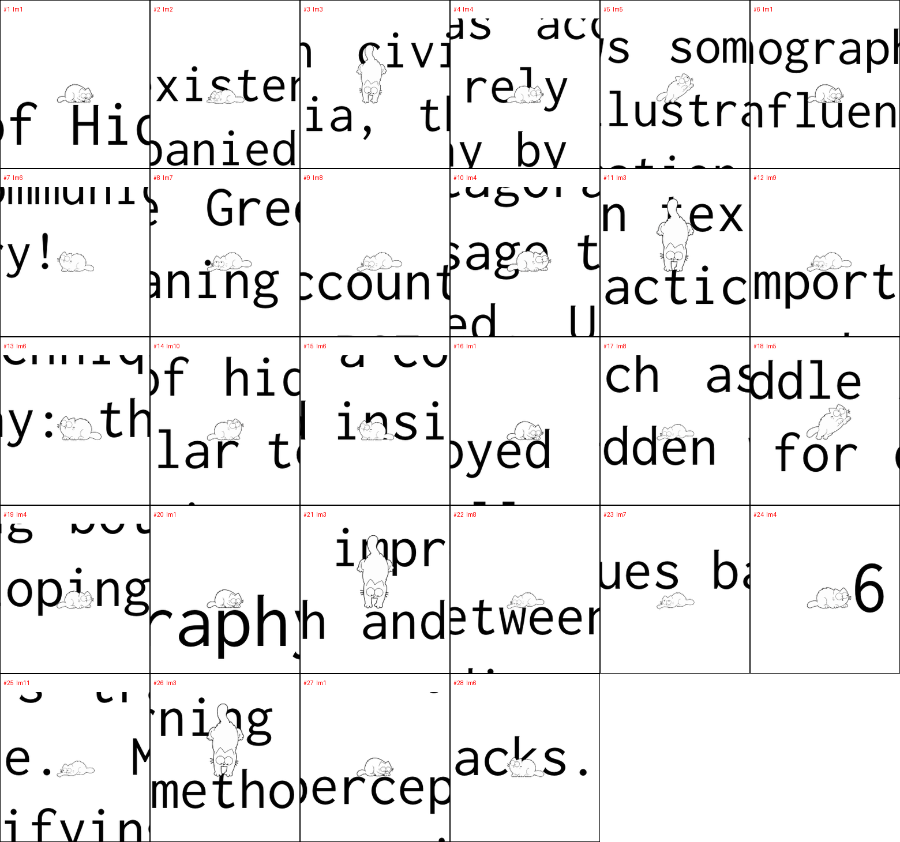
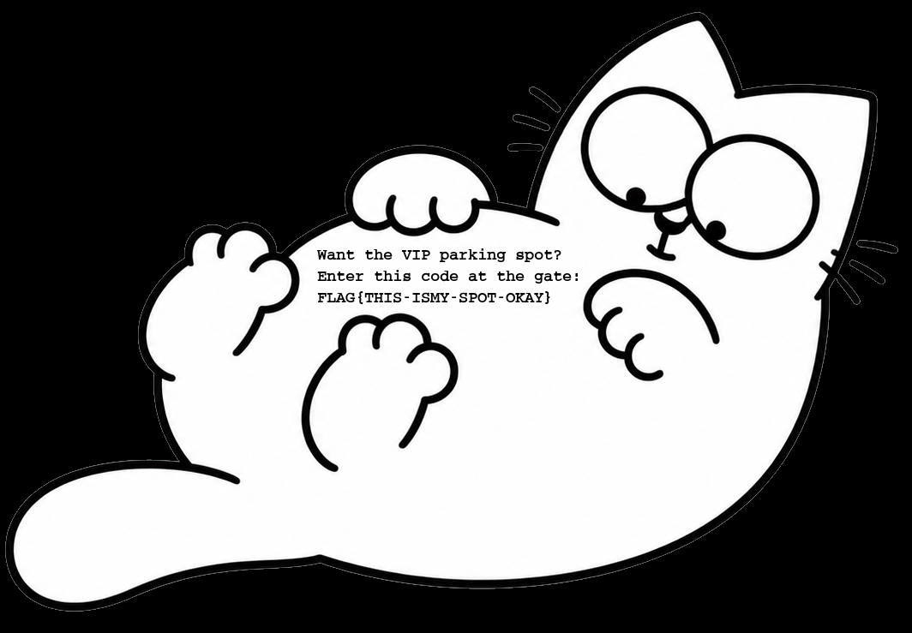

#### Challenge:

Hi Associate Researcher,

an anonymous source has shared a PDF document originating from the Department of Hidden Messages. At first glance, it appears to be nothing more than another copy of one of the department's routine public paper. However, the department has been distributing documents with nearly identical contents for quite some time, and the reason for doing so remains unclear. Your task is to analyze the document.

Stay curious!

Download the [PDF document](https://owncloud.cesnet.cz/index.php/s/VeHUHAxE9DeNVCW/download) (also mirrored as [document_DoHM.zip](./document_DoHM.zip ":ignore")).
(SHA256 fingerprint `95845f56dc4c0fa9c0dee4a1ee6c87991ea78cf76457b2404b6f6e5d83abb422`)

Hints (0 points):
- The department's employees collectively own **28 cats**.
- A capable PDF viewer with **sufficient zoom** may reveal details invisible at first sight — *even feline whiskers*.

---

#### Solution:

- the PDF is a 3-page LaTeX article ("The Early Origins of Steganography"). The visible text is a decoy essay; metadata/fonts carry nothing useful, and there are no raster images at all
    ```bash
    pdfinfo document_DoHM.pdf          # LaTeX/pdfTeX, 3 pages
    pdfimages -list document_DoHM.pdf  # no raster images
    pdffonts document_DoHM.pdf         # only Inconsolata
    ```
- red flag: ~900 KB for 3 pages of plain text with no images. Decompressing the PDF reveals a pile of Form XObjects (`Im1`–`Im11`), each drawn with a tiny scale matrix so a 600 pt figure renders as a ~7 pt **microdot** — invisible at 100 %, exactly what the "sufficient zoom" hint points at
    ```
    0.01181 0 0 0.01181 0 0 cm   /Im1 Do
    ```
- each `Im` is an embedded vector drawing of *Simon's Cat*. Counting the placements across both pages gives **28 cat placements** — matching the "28 cats" hint (11 distinct drawings; a few poses are re-traced near-identical copies, the challenge motif)
    ```
    page 1: Im1 Im2 Im3 Im4 Im5 Im1 Im6 Im7 Im8 Im4 Im3 Im9 Im6
    page 2: Im10 Im6 Im1 Im8 Im5 Im4 Im1 Im3 Im8 Im7 Im4 Im11 Im3 Im1 Im6
    ```
- the payload is **not** the cat identities nor the glyph each cat sits on. The trick is that **each cat *looks at* a glyph** — Simon's Cat has big eyes with offset pupils, so every drawing has a gaze direction. Rendering the pages at high DPI and cropping a tight window around each microdot makes the cat + neighbouring glyphs and the gaze orientation readable

    

- reading the character each cat's gaze points to, in document order, spells the lead:
    ```
    Hi, you! Got to :hiddenpaws6.tcc
    ```
- following the lead returns a page serving another Simon's Cat image:
    ```bash
    curl http://hiddenpaws6.tcc/
    # <title>Department of Hidden Messages</title> ... 
    curl -o image.png http://hiddenpaws6.tcc/image.png
    ```
- no EXIF and no text chunks, but a 2-colour line drawing carrying 10 551 unique colours is obviously hiding data. The RGB channels just draw the cat; the data lives in the **alpha channel** — white text painted onto the opaque cat body, invisible on white, readable when composited over black
    ```python
    import numpy as np
    from PIL import Image
    a = np.array(Image.open("image.png"))
    rgb, al = a[:, :, :3].astype(float), a[:, :, 3:4].astype(float) / 255
    Image.fromarray((rgb * al).astype("uint8")).save("flag_alpha_reveal.png")  # bg = black
    ```

    

---

<details><summary>FLAG:</summary>

```
FLAG{THIS-ISMY-SPOT-OKAY}
```

</details>
<br/>
